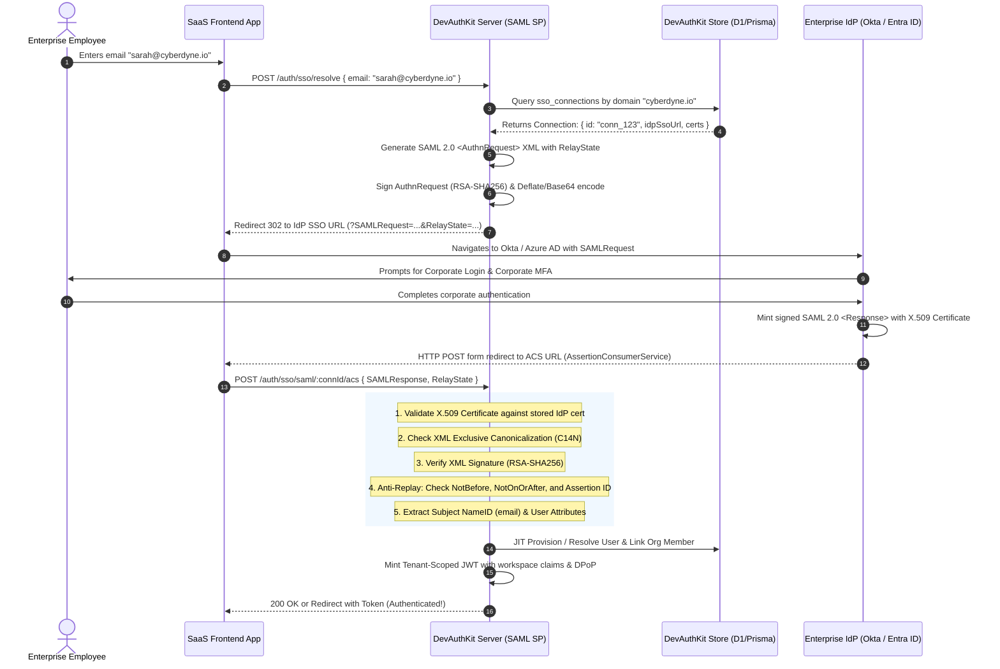
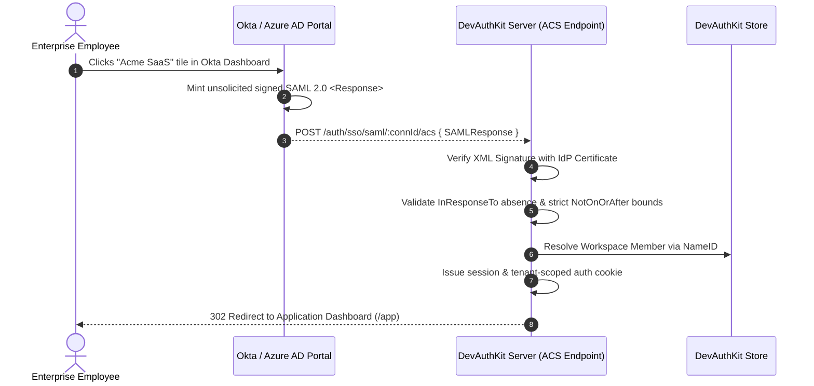
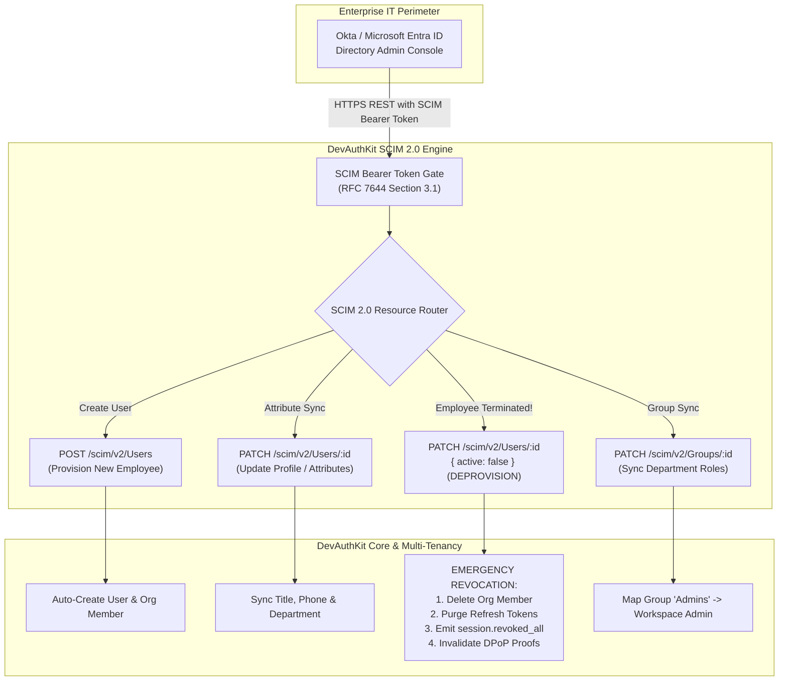
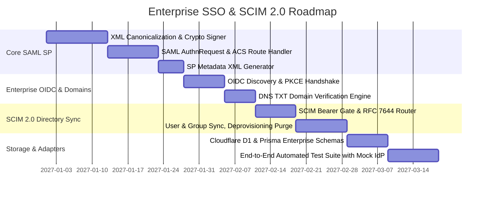

# 🏢 DevAuthKit: Enterprise SSO (SAML 2.0 & Enterprise OIDC) and SCIM 2.0 Directory Sync Architecture Specification
## The Self-Hosted, Zero-Fee Alternative to WorkOS and Auth0 Enterprise

**Document Version:** 1.0.0  
**Target Module:** `devauthkit/sso` & `devauthkit/scim`  
**Classification:** Enterprise Systems & Security Architecture Specification  
**Status:** Approved for Implementation  
**Author:** Strategic Engineering, Identity Federation & Cryptographic Security Architecture  

---

## 🎯 1. Executive Summary & The "SSO Wall" Problem Space

In B2B SaaS applications, closing six-figure deals with mid-market and Fortune 500 enterprises inevitably hits an immovable security prerequisite: **Enterprise Single Sign-On (SSO) and Directory Sync (SCIM 2.0)**.

Enterprise CISOs and IT administrators mandate:
1. **Centralized Identity Enforcement (SAML 2.0 / Enterprise OIDC):** Employees must log into vendor SaaS applications exclusively via the enterprise Identity Provider (IdP)—such as **Okta, Microsoft Entra ID (Azure AD), Google Workspace, or PingIdentity**—governed by corporate Multi-Factor Authentication (MFA) and Conditional Access Policies.
2. **Automated Lifecycle Deprovisioning (SCIM 2.0):** When an employee resigns or is terminated, disabling them in Okta or Entra ID must **instantly revoke their access and terminate all active sessions** in the downstream SaaS platform, eliminating orphaned zombie accounts and compliance exposure.
3. **Automated Group & Role Mapping:** Departmental groups in the IdP (e.g., `Engineering-Admins`, `Finance-Billing`) must automatically assign corresponding roles within the SaaS multi-tenant workspace.

### 1.1 The Extortionate "SSO Wall" Vendor Tax
Commercial authentication providers monetize this enterprise requirement with aggressive, predatory pricing:
- **WorkOS:** Charges **$125 per active connection per month** ($1,500/year per enterprise customer!). An application serving just 20 enterprise clients pays $30,000/year to a third-party vendor.
- **Clerk:** Gates SAML SSO behind enterprise tiers costing hundreds of dollars a month plus per-seat surcharges.
- **Auth0 / Okta Customer Identity:** Locks enterprise connections behind custom enterprise plans starting at **$800–$2,000/month**.

```
┌────────────────────────────────────────────────────────────────────────────────────────┐
│                        THE ENTERPRISE SSO MARKETPLACE COMPARISON                       │
├─────────────────────┬───────────────────────────┬──────────────────────────────────────┤
│ Provider            │ Cost per Enterprise Tenant│ Architectural Limitations            │
├─────────────────────┼───────────────────────────┼──────────────────────────────────────┤
│ WorkOS              │ $125 / connection / month │ Closed source, vendor lock-in        │
│ Auth0 Enterprise    │ $800+ / month base        │ Opaque pricing, data leaves your VPC │
│ Clerk Enterprise    │ Custom quote ($100s/mo)   │ Proprietary hosted UI requirements   │
│ DevAuthKit (Target) │ $0.00 / Zero Vendor Fees  │ 100% Self-Hosted, Node + Cloudflare  │
└─────────────────────┴───────────────────────────┴──────────────────────────────────────┘
```

### 1.2 DevAuthKit's Value Proposition
> **"Turnkey, self-hosted, multi-tenant SAML 2.0 Service Provider (SP), Enterprise OIDC, and SCIM 2.0 Directory Sync engine with zero vendor fees, zero per-connection surcharges, and dual-runtime support (Node.js/Express + Cloudflare Workers/Hono)."**  
> Enables any B2B SaaS startup to immediately pass Enterprise IT vendor security assessments without routing corporate identity traffic through third-party intermediaries.

---

## 🏛️ 2. High-Level Architectural Blueprint & Workflows

### 2.1 SP-Initiated SAML 2.0 Authentication Ceremony

In SP-Initiated SSO, the user attempts to log in from the application (e.g., by entering `sarah@cyberdyne.io`), and DevAuthKit automatically discovers their corporate IdP and redirects them for authentication:



---

### 2.2 IdP-Initiated SAML 2.0 SSO Flow

In IdP-Initiated SSO, the enterprise user clicks the SaaS application tile directly from their corporate **Okta Dashboard** or **Microsoft My Apps portal**:



---

### 2.3 Automated SCIM 2.0 Directory Sync Pipeline (RFC 7643 & RFC 7644)

When an enterprise IT administrator assigns or removes employees from the application group in Okta or Azure AD, the enterprise IdP calls DevAuthKit's standardized SCIM 2.0 endpoints via HTTP REST:



---

## 🔐 3. SAML 2.0 Service Provider (SP) Cryptographic Engine

DevAuthKit implements a high-performance, native SAML 2.0 Service Provider (SP) engine designed to run seamlessly on both **Node.js** and **Edge V8 environments (Cloudflare Workers)** without bulky legacy native C++ dependencies (such as `libxml2`).

### 3.1 XML Canonicalization & Signature Verification
SAML 2.0 digital signatures are computed over canonicalized XML trees:
1. **Canonicalization Algorithm:** `http://www.w3.org/2001/10/xml-exc-c14n#` (Exclusive XML Canonicalization / RFC 3741), stripping arbitrary attribute ordering and whitespace differences without breaking signatures.
2. **Signature Digest Algorithms:** Supports both `http://www.w3.org/2001/04/xmlenc#sha256` and `http://www.w3.org/2000/09/xmldsig#sha1` (with warnings for SHA-1 legacy IdPs).
3. **Signature Algorithms:**
   - `http://www.w3.org/2001/04/xmldsig-more#rsa-sha256` (Standard)
   - `http://www.w3.org/2007/05/xmldsig-more#sha256-rsa-MGF1` (RSA-PSS)

### 3.2 Anti-Replay & Temporal Integrity Verification
To prevent replay attacks where an eavesdropped SAML assertion is submitted multiple times:
1. **Assertion ID Deduplication:** Every assertion carries a unique identifier (`ID="pfx..."`). DevAuthKit stores processed assertion IDs in the replay store (Memory, Redis, or Cloudflare KV/D1) with a 10-minute TTL. Re-submitting the same Assertion ID fails with `ERR_SAML_ASSERTION_REPLAYED`.
2. **Strict Time Bounds:** The `<Conditions>` element defines validity bounds:
   $$\text{NotBefore} - \text{skew} \le \text{CurrentTimestamp} < \text{NotOnOrAfter} + \text{skew}$$
   Default allowable clock skew ($\text{skew}$) is 60 seconds.

### 3.3 Zero-Downtime Multi-Certificate Rolling Rollover
Enterprise IdPs rotate their X.509 signing certificates every 1–2 years. If an auth provider only supports a single active certificate, rotating the cert causes an instant global login outage until the SaaS admin updates the configuration.

DevAuthKit supports **Dual Rolling Certificates**:
- Connections store `idpCertificates: string[]`.
- Signature verification attempts the primary certificate; if verification fails, it falls back to the decaying secondary certificate.
- When the new certificate succeeds, it is automatically promoted to primary.

### 3.4 Service Provider (SP) Metadata Generation
Enterprise IT admins require an SP Metadata XML file to configure DevAuthKit in Okta / Azure AD. DevAuthKit auto-generates this dynamically per connection:

`GET /auth/sso/saml/:connectionId/metadata`
```xml
<?xml version="1.0" encoding="UTF-8"?>
<md:EntityDescriptor xmlns:md="urn:oasis:names:tc:SAML:2.0:metadata"
  entityID="https://api.myapp.com/auth/sso/saml/conn_123">
  <md:SPSSODescriptor AuthnRequestsSigned="true" WantAssertionsSigned="true"
    protocolSupportEnumeration="urn:oasis:names:tc:SAML:2.0:protocol">
    <md:KeyDescriptor use="signing">
      <ds:KeyInfo xmlns:ds="http://www.w3.org/2000/09/xmldsig#">
        <ds:X509Data>
          <ds:X509Certificate>MIIDPTCCAiWgAwIBAgIU...</ds:X509Certificate>
        </ds:X509Data>
      </ds:KeyInfo>
    </md:KeyDescriptor>
    <md:SingleLogoutService Binding="urn:oasis:names:tc:SAML:2.0:bindings:HTTP-POST"
      Location="https://api.myapp.com/auth/sso/saml/conn_123/slo"/>
    <md:NameIDFormat>urn:oasis:names:tc:SAML:1.1:nameid-format:emailAddress</md:NameIDFormat>
    <md:AssertionConsumerService Binding="urn:oasis:names:tc:SAML:2.0:bindings:HTTP-POST"
      Location="https://api.myapp.com/auth/sso/saml/conn_123/acs" index="1" isDefault="true"/>
  </md:SPSSODescriptor>
</md:EntityDescriptor>
```

---

## 🌐 4. Enterprise OIDC Federation

In addition to SAML 2.0, modern enterprises frequently prefer **OpenID Connect (OIDC)** for cloud-native directories (e.g., Microsoft Entra ID and Google Workspace):

### 4.1 Automated OIDC Discovery & PKCE
1. **OIDC Discovery:** Enterprise admin provides the IdP Issuer URL (e.g., `https://login.microsoftonline.com/{tenant}/v2.0`). DevAuthKit automatically fetches `/.well-known/openid-configuration` to discover authorization, token, and JWKS endpoints.
2. **PKCE Enforcement:** DevAuthKit generates an ephemeral high-entropy cryptographic code verifier and code challenge (`S256`) for every authentication request, mitigating authorization code injection attacks.
3. **ID Token Cryptographic Verification:** Verifies RSA/EC signatures against the IdP's live JWKS, validating `iss`, `aud`, `exp`, and `nonce`.

---

## 🎯 5. Intelligent Domain-Based IdP Routing & DNS Verification

### 5.1 Zero-Friction Enterprise Login
Instead of requiring enterprise employees to bookmark custom login URLs, DevAuthKit provides **Universal Domain-Based Routing**:
1. User enters their work email: `sarah@cyberdyne.io`.
2. DevAuthKit extracts the domain `cyberdyne.io`.
3. If `cyberdyne.io` is claimed by an active `SsoConnection`, the server immediately responds with `{ ssoRedirectUrl: "..." }`, initiating the corporate IdP flow without prompting for OTP, passwords, or personal credentials.

### 5.2 DNS TXT Record Domain Claim Verification
To prevent domain hijacking (e.g., malicious tenant claiming `@google.com`), enterprise connections mandate domain verification:

```text
Domain Verification Record:
Type:  TXT
Host:  _devauth-verify.cyberdyne.io
Value: devauth-domain-verification=9f8a1b2c3d4e5f6a7b8c9d0e
```

DevAuthKit queries DNS TXT records via DNS-over-HTTPS (DoH) or Node `dns.promises.resolveTxt`. Only verified domains unlock domain-based login routing.

---

## 👥 6. SCIM 2.0 Directory Synchronization Protocol (RFC 7643 & RFC 7644)

The **System for Cross-domain Identity Management (SCIM 2.0)** provides the standard REST API that Okta, Azure AD, and OneLogin invoke to synchronize employee directories:

### 6.1 Standard SCIM 2.0 Endpoints
All SCIM routes are mounted under `/scim/v2` and authenticated via a dedicated, revocable `Bearer <scim_token>` generated per organization workspace:

| Method | SCIM Endpoint | Action & Business Logic |
| :--- | :--- | :--- |
| `GET` | `/scim/v2/ServiceProviderConfig` | Returns SCIM specification capabilities (patch, filter, bulk). |
| `GET` | `/scim/v2/Schemas` | Returns schemas for `urn:ietf:params:scim:schemas:core:2.0:User` and `Group`. |
| `GET` | `/scim/v2/Users` | Paginated search of workspace members with filter parsing (`filter=userName eq "sarah@cyberdyne.io"`). |
| `POST` | `/scim/v2/Users` | Provision new employee: Creates user account and assigns to workspace. |
| `GET` | `/scim/v2/Users/:id` | Retrieve SCIM user representation. |
| `PUT` | `/scim/v2/Users/:id` | Full replacement of user attributes. |
| `PATCH`| `/scim/v2/Users/:id` | **Critical Lifecycle Endpoint:** Attribute updates and employee deactivation (`Operations: [{ op: "replace", path: "active", value: false }]`). |
| `DELETE`| `/scim/v2/Users/:id` | Remove user from organization. |
| `GET` | `/scim/v2/Groups` | List synchronized directory groups. |
| `POST` | `/scim/v2/Groups` | Register group for role mapping. |
| `PATCH`| `/scim/v2/Groups/:id` | Add/remove group members, synchronizing SaaS workspace roles. |

---

### 6.2 Instant Deprovisioning & Emergency Session Purge
When an employee is offboarded in Okta, the IdP sends:
`PATCH /scim/v2/Users/usr_948194821`
```json
{
  "schemas": ["urn:ietf:params:scim:api:messages:2.0:PatchOp"],
  "Operations": [
    {
      "op": "replace",
      "path": "active",
      "value": false
    }
  ]
}
```

DevAuthKit's SCIM engine executes an atomic cascade:
1. Marks `active = 0` in `organization_members`.
2. Immediately revokes all refresh tokens and families for that user via `refreshTokenStore.revokeAll(userId)`.
3. Emits `session.revoked_all` and `org.member_removed` over the internal Webhook Event Bus.
4. Any in-flight access tokens are rejected on their next request via revocation cache checking.

---

## 🗄️ 7. Multi-Tenant Database Schema Specification

### 7.1 Cloudflare D1 SQL Schema (`schema_d1_sso.sql`)

```sql
-- ==========================================================
-- DevAuthKit Enterprise SSO & SCIM 2.0 Schema
-- ==========================================================

-- Enterprise SSO Identity Connections
CREATE TABLE IF NOT EXISTS sso_connections (
  id TEXT PRIMARY KEY,
  org_id TEXT NOT NULL,
  name TEXT NOT NULL,                         -- e.g. "Cyberdyne Okta SSO"
  type TEXT NOT NULL,                         -- 'SAML' | 'OIDC'
  domains TEXT NOT NULL,                      -- JSON array e.g. '["cyberdyne.io"]'
  domain_verified INTEGER NOT NULL DEFAULT 0, -- 1 = verified via DNS TXT
  domain_verification_token TEXT NOT NULL,
  
  -- SAML Specific Fields
  idp_entity_id TEXT,
  idp_sso_url TEXT,
  idp_slo_url TEXT,
  idp_certificates TEXT,                      -- JSON array of X.509 cert PEM strings
  sp_entity_id TEXT NOT NULL,
  sp_acs_url TEXT NOT NULL,
  
  -- OIDC Specific Fields
  oidc_issuer TEXT,
  oidc_client_id TEXT,
  oidc_client_secret TEXT,
  oidc_discovery_url TEXT,
  
  -- Settings & Defaults
  default_role TEXT NOT NULL DEFAULT 'member',
  attribute_mapping TEXT,                     -- JSON mapping IdP claims -> user fields
  active INTEGER NOT NULL DEFAULT 1,
  created_at INTEGER NOT NULL,
  updated_at INTEGER NOT NULL,
  FOREIGN KEY (org_id) REFERENCES organizations(id) ON DELETE CASCADE
);

-- SCIM 2.0 Directory Configurations
CREATE TABLE IF NOT EXISTS scim_directories (
  id TEXT PRIMARY KEY,
  org_id TEXT NOT NULL,
  bearer_token_hash TEXT NOT NULL UNIQUE,     -- SHA-256 hash of SCIM API secret
  active INTEGER NOT NULL DEFAULT 1,
  scim_base_url TEXT NOT NULL,
  last_synced_at INTEGER,
  created_at INTEGER NOT NULL,
  updated_at INTEGER NOT NULL,
  FOREIGN KEY (org_id) REFERENCES organizations(id) ON DELETE CASCADE
);

-- SCIM Synchronized User Identifiers
CREATE TABLE IF NOT EXISTS scim_user_mappings (
  id TEXT PRIMARY KEY,
  directory_id TEXT NOT NULL,
  org_id TEXT NOT NULL,
  user_id TEXT NOT NULL,
  idp_external_id TEXT NOT NULL,              -- Okta/Entra ID User GUID
  attributes TEXT,                            -- JSON snapshot of corporate metadata
  active INTEGER NOT NULL DEFAULT 1,
  created_at INTEGER NOT NULL,
  updated_at INTEGER NOT NULL,
  FOREIGN KEY (directory_id) REFERENCES scim_directories(id) ON DELETE CASCADE,
  FOREIGN KEY (org_id) REFERENCES organizations(id) ON DELETE CASCADE,
  UNIQUE(directory_id, idp_external_id)
);

-- SCIM Synchronized Groups & Role Mappings
CREATE TABLE IF NOT EXISTS scim_group_mappings (
  id TEXT PRIMARY KEY,
  directory_id TEXT NOT NULL,
  org_id TEXT NOT NULL,
  idp_group_id TEXT NOT NULL,                 -- Okta/Entra ID Group GUID
  group_name TEXT NOT NULL,                   -- e.g. "DevOps Engineers"
  mapped_org_role TEXT NOT NULL,              -- e.g. "admin"
  created_at INTEGER NOT NULL,
  FOREIGN KEY (directory_id) REFERENCES scim_directories(id) ON DELETE CASCADE,
  UNIQUE(directory_id, idp_group_id)
);

CREATE INDEX IF NOT EXISTS idx_sso_connections_org ON sso_connections(org_id);
CREATE INDEX IF NOT EXISTS idx_scim_user_idp ON scim_user_mappings(directory_id, idp_external_id);
```

---

### 7.2 Prisma Schema (`schema.prisma`)

```prisma
model SsoConnection {
  id                      String       @id @default(uuid())
  orgId                   String
  name                    String
  type                    String       // "SAML" | "OIDC"
  domains                 String[]
  domainVerified          Boolean      @default(false)
  domainVerificationToken String
  
  // SAML
  idpEntityId             String?
  idpSsoUrl               String?
  idpSloUrl               String?
  idpCertificates         String[]
  spEntityId              String
  spAcsUrl                String
  
  // OIDC
  oidcIssuer              String?
  oidcClientId            String?
  oidcClientSecret        String?
  oidcDiscoveryUrl        String?
  
  defaultRole             String       @default("member")
  attributeMapping        Json?
  active                  Boolean      @default(true)
  createdAt               DateTime     @default(now())
  updatedAt               DateTime     @updatedAt

  organization            Organization @relation(fields: [orgId], references: [id], onDelete: Cascade)

  @@index([orgId])
  @@map("devauth_sso_connections")
}

model ScimDirectory {
  id              String            @id @default(uuid())
  orgId           String
  bearerTokenHash String            @unique
  active          Boolean           @default(true)
  scimBaseUrl     String
  lastSyncedAt    DateTime?
  createdAt       DateTime          @default(now())
  updatedAt       DateTime          @updatedAt

  organization    Organization      @relation(fields: [orgId], references: [id], onDelete: Cascade)
  userMappings    ScimUserMapping[]
  groupMappings   ScimGroupMapping[]

  @@map("devauth_scim_directories")
}

model ScimUserMapping {
  id            String        @id @default(uuid())
  directoryId   String
  orgId         String
  userId        String
  idpExternalId String
  attributes    Json?
  active        Boolean       @default(true)
  createdAt     DateTime      @default(now())
  updatedAt     DateTime      @updatedAt

  directory     ScimDirectory @relation(fields: [directoryId], references: [id], onDelete: Cascade)

  @@unique([directoryId, idpExternalId])
  @@map("devauth_scim_user_mappings")
}

model ScimGroupMapping {
  id            String        @id @default(uuid())
  directoryId   String
  orgId         String
  idpGroupId    String
  groupName     String
  mappedOrgRole String
  createdAt     DateTime      @default(now())

  directory     ScimDirectory @relation(fields: [directoryId], references: [id], onDelete: Cascade)

  @@unique([directoryId, idpGroupId])
  @@map("devauth_scim_group_mappings")
}
```

---

## 🔌 8. REST Management API Specification

### 8.1 SSO Administrative Endpoints (`/auth/sso`)

| Method | Endpoint | Description | Auth Required |
| :--- | :--- | :--- | :--- |
| `POST` | `/auth/sso/connections` | Create a new SAML or OIDC enterprise connection | Workspace Owner / Admin |
| `GET` | `/auth/sso/connections` | List all enterprise connections for active workspace | Workspace Member |
| `GET` | `/auth/sso/connections/:id` | Get connection details, status & SP URLs | Workspace Member |
| `PATCH`| `/auth/sso/connections/:id` | Update IdP URLs, X.509 certs, or attribute mapping | Workspace Owner / Admin |
| `DELETE`| `/auth/sso/connections/:id` | Delete connection | Workspace Owner |
| `POST` | `/auth/sso/connections/:id/verify-domain` | Trigger live DNS TXT lookup to verify domain ownership | Workspace Owner / Admin |
| `GET` | `/auth/sso/saml/:id/metadata` | Public SP Metadata XML for Okta/Entra ID import | Public |
| `POST` | `/auth/sso/saml/:id/acs` | SAML Assertion Consumer Service (Receives IdP response) | Public (Signed XML) |
| `POST` | `/auth/sso/resolve` | Discover SSO connection by email domain (`{ email }`) | Public |

### 8.2 SCIM 2.0 Directory Management Endpoints (`/auth/scim`)

| Method | Endpoint | Description | Auth Required |
| :--- | :--- | :--- | :--- |
| `POST` | `/auth/scim/directories` | Generate SCIM directory credentials & bearer token | Workspace Owner |
| `GET` | `/auth/scim/directories` | Get active SCIM directory status and sync logs | Workspace Owner / Admin |
| `POST` | `/auth/scim/directories/:id/rotate-token` | Rotate SCIM bearer token | Workspace Owner |
| `POST` | `/auth/scim/directories/:id/group-mappings` | Map corporate IdP Group $\rightarrow$ Workspace Role | Workspace Owner / Admin |

---

## 🛡️ 9. Security Threat Mitigations & Hardening

1. **XML External Entity (XXE) Injection Immunity:**
   The SAML XML parser explicitly disables external DTD resolution, external parameter entities, and external stylesheets:
   ```javascript
   // Strict XML parser configuration
   {
     resolveExternalEntities: false,
     disallowDocType: false,
     validateSchema: false,
     maxPayloadSizeBytes: 512 * 1024 // 512KB Max SAML Payload
   }
   ```
2. **XML Signature Wrapping (XSW) Attack Defense:**
   Attackers attempt to alter user identity by placing a forged `<Assertion>` beside the authentic signed `<Assertion>`. DevAuthKit mitigates XSW by extracting the exact element reference targeted by the signature's `URI` attribute, verifying the signature directly against that element, and rejecting any XML containing duplicate or ambiguous Assertion IDs.
3. **Canonicalization Injection Defense:**
   Only Exclusive XML Canonicalization (`C14N`) without comments is permitted to prevent namespace injection attacks.
4. **SCIM Token Security:**
   SCIM bearer tokens are generated with 256 bits of CSPRNG entropy (`scim_live_...`). The database stores only the irreversible **SHA-256 hash** of the token.

---

## 💻 10. Developer SDK Experience

### 10.1 Universal Client Login Helper (`DevAuthClient`)
```typescript
import { DevAuthClient } from "devauthkit/client";

const auth = new DevAuthClient({ apiUrl: "https://api.myapp.com" });

// 1. Unified enterprise login: auto-detects SSO vs OTP
const loginResult = await auth.loginWithEmail("alex@cyberdyne.io");

if (loginResult.type === "sso_redirect") {
  // User belongs to an enterprise with SAML/OIDC: redirect to Okta
  window.location.href = loginResult.ssoRedirectUrl;
} else {
  // Standard consumer user: prompt for OTP or Magic Link
  showOtpCodeModal();
}
```

### 10.2 Server Setup with Enterprise SSO Enabled
```javascript
const devAuthKit = require("devauthkit");

devAuthKit(app, {
  jwtSecret: process.env.JWT_SECRET,
  organizations: true,
  sso: {
    enabled: true,
    spBaseUrl: "https://api.myapp.com",
    allowIdpInitiated: true, // Support Okta dashboard launch tiles
    enforceDomainVerification: true
  },
  scim: {
    enabled: true,
    path: "/scim/v2"
  }
});
```

---

## 📅 11. Phased Implementation Roadmap



| Phase | Milestone | Deliverables |
| :---: | :--- | :--- |
| **Phase 1** | **SAML 2.0 Engine & SP Metadata** | XML C14N canonicalization, RSA-SHA256 signature verification, AuthnRequest generator, dynamic SP Metadata XML endpoint. |
| **Phase 2** | **Enterprise OIDC & Domain Discovery** | OIDC discovery, PKCE exchange, DoH DNS TXT domain verification engine (`_devauth-verify`). |
| **Phase 3** | **SCIM 2.0 Server Protocol** | RFC 7643/7644 endpoints (`/scim/v2/Users`, `/scim/v2/Groups`), bearer token hashing, JIT provisioning, instant session purge on `active: false`. |
| **Phase 4** | **Multi-Tenant Storage Adapters** | Concrete `SsoStore` & `ScimStore` implementations for Cloudflare D1, Prisma, Drizzle, and Memory. |
| **Phase 5** | **Management API & Client SDK** | Administrative routes (`/auth/sso/connections`), `DevAuthClient.sso` and `DevAuthClient.scim` SDK methods. |
| **Phase 6** | **Security Hardening & Mock IdP Test Suite** | Automated test suite verifying SAML XML with simulated Okta/Entra ID responses, XXE injection attack defense, and SCIM sync. |

---

## 🧪 12. Verification & Automated Test Checklist

- [ ] **1. XML Signature Verification:** Validates RSA-SHA256 signatures against real Okta, Microsoft Entra ID, and Google Workspace assertions.
- [ ] **2. Anti-Replay Assertion ID:** Reject re-submitted assertions with `ERR_SAML_ASSERTION_REPLAYED`.
- [ ] **3. Strict Clock Skew Bounds:** Assertions outside `NotBefore`/`NotOnOrAfter` tolerance fail verification.
- [ ] **4. XXE Injection Resistance:** XML with external entities or DTD entity expansion is blocked.
- [ ] **5. XML Signature Wrapping (XSW) Defense:** Rejects payloads with duplicated or modified `<Assertion>` elements.
- [ ] **6. Rolling Certificate Promotion:** Seamless failover to secondary certificate during key rollover.
- [ ] **7. DNS TXT Domain Verification:** Validates domain ownership via `_devauth-verify.<domain>`.
- [ ] **8. SCIM 2.0 User Provisioning:** `POST /scim/v2/Users` creates user and workspace member.
- [ ] **9. SCIM Instant Deprovisioning:** `PATCH /scim/v2/Users/:id` with `active: false` purges all active refresh tokens and revokes sessions.
- [ ] **10. Dual Runtime Compatibility:** Zero C++ native dependencies; runs cleanly on Node.js 18+ and Cloudflare Workers (Edge V8).
