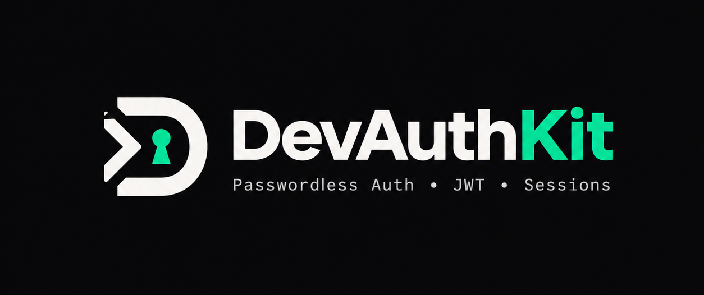

# 🔄 DevAuthKit — Migration Guide
## Version Upgrades, Schema Evolution & Vendor Migration

<p align="center">
  
</p>

<p align="center">
  <strong>Transition cleanly to self-hosted, enterprise-grade authentication.</strong><br/>
  Zero vendor lock-in. Predictable infrastructure costs. Full data custody.
</p>

---

[](<https://github.com/GautamSharma-coder/devauthkit>)

## 📑 Table of Contents

1. [Executive Summary & Migration Principles](#1-executive-summary--migration-principles)
2. [DevAuthKit Version Upgrade Matrix (v1.0 → v1.11.0)](#2-devauthkit-version-upgrade-matrix-v10--v1110)
   - [2.1 Upgrading from v1.0–v1.3 to v1.4+ (Refresh Tokens & Rotation)](#21-upgrading-from-v10v13-to-v14-refresh-tokens--rotation)
   - [2.2 Upgrading from v1.4 to v1.8+ (DPoP RFC 9449, Passkeys & TOTP MFA)](#22-upgrading-from-v14-to-v18-dpop-rfc-9449-passkeys--totp-mfa)
   - [2.3 Upgrading from v1.8 to v1.9+ (Organizations, Webhooks & Enterprise SSO/SCIM)](#23-upgrading-from-v18-to-v19-organizations-webhooks--enterprise-ssoscim)
   - [2.4 Upgrading from v1.9 to v1.10+ (Audit Trails, API Keys, Sessions & Impersonation)](#24-upgrading-from-v19-to-v110-audit-trails-api-keys-sessions--impersonation)
   - [2.5 Breaking Changes & Deprecations History](#25-breaking-changes--deprecations-history)
3. [Database Schema Migrations & DDL Specifications](#3-database-schema-migrations--ddl-specifications)
   - [3.1 Prisma Schema & Migrations](#31-prisma-schema--migrations)
   - [3.2 Drizzle ORM Schema (PostgreSQL & SQLite)](#32-drizzle-orm-schema-postgresql--sqlite)
   - [3.3 Cloudflare D1 SQL Schema (`schema.d1.sql`)](#33-cloudflare-d1-sql-schema-schemad1sql)
   - [3.4 Raw PostgreSQL DDL Schema](#34-raw-postgresql-ddl-schema)
4. [Migrating from External Authentication Providers](#4-migrating-from-external-authentication-providers)
   - [4.1 Migrating from Clerk to DevAuthKit (Fixed Infrastructure Costs)](#41-migrating-from-clerk-to-devauthkit-fixed-infrastructure-costs)
   - [4.2 Migrating from Auth0 / Okta to DevAuthKit (Self-Hosted SSO & Audit Logs)](#42-migrating-from-auth0--okta-to-devauthkit-self-hosted-sso--audit-logs)
   - [4.3 Migrating from NextAuth.js / Auth.js to DevAuthKit (Deterministic Simplicity)](#43-migrating-from-nextauthjs--authjs-to-devauthkit-deterministic-simplicity)
   - [4.4 Migrating from WorkOS to DevAuthKit (Self-Hosted SAML & SCIM)](#44-migrating-from-workos-to-devauthkit-self-hosted-saml--scim)
   - [4.5 Migrating from Passport.js / Custom Express Sessions to DevAuthKit](#45-migrating-from-passportjs--custom-express-sessions-to-devauthkit)
5. [Frontend & Client SDK Migration](#5-frontend--client-sdk-migration)
   - [5.1 Initializing `DevAuthClient`](#51-initializing-devauthclient)
   - [5.2 Replacing Ad-Hoc Fetch & Token Management](#52-replacing-ad-hoc-fetch--token-management)
   - [5.3 Reactive State with `onAuthStateChanged`](#53-reactive-state-with-onauthstatechanged)
   - [5.4 Drop-In React Components & Hooks (`devauthkit/react`)](#54-drop-in-react-components--hooks-devauthkitreact)
6. [Zero-Downtime Deployment & Cutover Strategy](#6-zero-downtime-deployment--cutover-strategy)
   - [6.1 Dual-Write & Shadow Verification](#61-dual-write--shadow-verification)
   - [6.2 Password Hash Migration (Lazy Re-Hashing vs. OTP Transition)](#62-password-hash-migration-lazy-re-hashing-vs-otp-transition)
   - [6.3 Phased Cutover Checklist](#63-phased-cutover-checklist)
7. [Troubleshooting & Common Pitfalls](#7-troubleshooting--common-pitfalls)

---

## 🎯 1. Executive Summary & Migration Principles

Many engineering teams evaluate self-hosted authentication to avoid per-MAU pricing tiers, keep customer identities inside their own database, and eliminate external network hops on the critical request path.

**DevAuthKit** delivers an enterprise-grade, self-hosted authentication suite for Express, Hono, and Cloudflare Workers.

When planning your migration, DevAuthKit adheres to four core guarantees:
1. **Zero Downtime:** Schema extensions are backward-compatible. New database columns supply safe default values (`revocation_epoch = 1`, `status = 'active'`).
2. **Data Sovereignty:** All user credentials, sessions, audit records, and cryptographic keys reside entirely in your VPC, SQLite/D1 database, or PostgreSQL instance.
3. **Isomorphic Runtime Portability:** Run identical business logic on Node.js (18+), Cloudflare Workers, Vercel Edge, AWS Lambda, Deno, or Bun without native C++ addons.
4. **Gradual Adoption:** You can run DevAuthKit in parallel with your existing auth provider, migrating traffic endpoint by endpoint or tenant by tenant.

---

## 🚀 2. DevAuthKit Version Upgrade Matrix (v1.0 → v1.11.0)

| Release Track | Key Architectural Capabilities Added | Breaking Changes | Migration Difficulty |
| :--- | :--- | :--- | :---: |
| **v1.0.x → v1.3.x** | Passwordless Email OTP, Magic Links, JWT Bearer tokens, `httpOnly` cookies, Resend email provider, Prisma adapter, Google OAuth PKCE. | None. Additive features. | 🟢 Trivial |
| **v1.4.x → v1.5.x** | Rotating refresh tokens, reuse detection family revocation, isomorphic Web Crypto API abstraction. | Insecure dev secrets rejected in production (`NODE_ENV=production`). | 🟡 Low |
| **v1.6.x → v1.8.x** | RFC 9449 DPoP key binding, WebAuthn/Passkeys (FIDO2), TOTP 2FA + step-up `requireMfa`. | `dpopReplayStore` required when DPoP is enabled. | 🟡 Low |
| **v1.9.0** | Multi-Tenant Organizations, Webhooks Engine (HMAC-SHA256), Enterprise SAML 2.0 SSO, SCIM 2.0 Directory Sync. | Added `/auth/orgs`, `/auth/webhooks`, `/auth/sso`, `/auth/scim` route namespaces. | 🟠 Moderate |
| **v1.10.x** | Merkle-chained Audit Trail (`audit_logs`), Scoped Machine API Keys (`api_keys`), Multi-Device Session Orchestrator (`sessions`), RFC 8693 User Impersonation, Monotonic Revocation Epochs, Hono parity. | User schema adds `status` and `revocation_epoch` for v2-spec features. | 🟠 Moderate |
| **v1.11.0** | Interactive CLI (`devauthkit` / Studio UI), Drop-in React UI Components (`devauthkit/client/react`), Email OTP example flow, Security Hardening across SSO/SAML/SCIM/Webhooks/Auth/Hono & dedicated regression test suite. | Strict tenant/admin authorization, SSRF validation on webhooks, and strict `Host` header validation (`devMode` no longer auto-enabled in production). | 🟢 Low |

---

### 2.1 Upgrading from v1.0–v1.3 to v1.4+ (Refresh Tokens & Rotation)

In v1.4.0, DevAuthKit introduced **rotating refresh tokens** to protect against stolen access tokens while keeping session lifetimes extended securely.

#### 1. Configuration Changes
Pass `refreshTokens` and a `refreshTokenStore` to `devAuthKit(app, options)`:

```javascript
// BEFORE (v1.0 - v1.3)
const devAuthKit = require("devauthkit");
devAuthKit(app, {
  jwtSecret: process.env.JWT_SECRET,
  userAdapter: devAuthKit.prismaAdapter(prisma)
});

// AFTER (v1.4+)
const devAuthKit = require("devauthkit");
const { RedisRefreshTokenStore, prismaAdapter } = devAuthKit;
// Or for development/single-instance testing: devAuthKit.MemoryRefreshTokenStore

devAuthKit(app, {
  jwtSecret: process.env.JWT_SECRET,
  sessionSecret: process.env.SESSION_SECRET, // Required in production for secure cookie signing
  userAdapter: prismaAdapter(prisma),
  refreshTokenStore: new RedisRefreshTokenStore(redisClient), // Or CloudflareD1RefreshTokenStore
  refreshTokens: {
    accessTokenExpiresIn: "15m",
    refreshTokenExpiresInDays: 30
  }
});
```

#### 2. Client Refresh Handling
Clients receive both an `accessToken` (short-lived, `15m` by default) and an `httpOnly` refresh cookie. The client can call `refresh()` directly when needed:
```javascript
const { DevAuthClient } = require("devauthkit/client");
const client = new DevAuthClient({
  apiUrl: window.location.origin,
  apiPrefix: "/auth"
});
await client.refresh();
```

---

### 2.2 Upgrading from v1.4 to v1.8+ (DPoP RFC 9449, Passkeys & TOTP MFA)

v1.6–v1.8 introduced hardware-level token theft protection (DPoP) and biometric/TOTP authentication.

#### 1. DPoP Token Binding (RFC 9449)
DPoP requires a replay store to prevent proof replay attacks:

```javascript
const devAuthKit = require("devauthkit");
const { RedisDpopReplayStore } = devAuthKit;

devAuthKit(app, {
  jwtSecret: process.env.JWT_SECRET,
  sessionSecret: process.env.SESSION_SECRET,
  dpop: "optional", // "optional" | "required" | { mode: "optional" | "required" | "disabled" }
  dpopReplayStore: new RedisDpopReplayStore(redisClient) // Required when dpop is enabled
});
```

#### 2. TOTP MFA & Step-Up Auth
Add `mfaStore` and configure `mfaIssuer`:

```javascript
const { MemoryMfaStore } = require("devauthkit");

devAuthKit(app, {
  // ...
  mfaStore: new MemoryMfaStore(), // Or a persistent MfaStore implementation
  mfaIssuer: "MyCompany",
  mfaStepUpExpiresInSeconds: 300 // 5 minutes step-up validity
});
```

Protect sensitive routes with `requireMfa`:
```javascript
const { requireAuth, requireMfa } = require("devauthkit");

app.post("/api/billing/payout", requireAuth, requireMfa, (req, res) => {
  res.json({ success: true });
});
```

---

### 2.3 Upgrading from v1.8 to v1.9+ (Organizations, Webhooks & Enterprise SSO/SCIM)

v1.9.0 added turnkey B2B multi-tenancy, cryptographic webhooks, SAML 2.0 / OIDC enterprise single sign-on, and automated SCIM 2.0 provisioning.

#### 1. Organization & Multi-Tenancy Store
```javascript
const { MemoryOrganizationStore } = require("devauthkit");
// For Cloudflare D1:
// const { CloudflareD1OrganizationStore } = require("devauthkit/stores/cloudflare-d1-organizations");

devAuthKit(app, {
  // ...
  organizations: true,
  organizationStore: new MemoryOrganizationStore() // Or new CloudflareD1OrganizationStore(env.DB)
});
```

#### 2. Cryptographic Webhooks
```javascript
const { MemoryWebhookStore, CloudflareD1WebhookStore } = require("devauthkit");

devAuthKit(app, {
  // ...
  webhooks: true,
  webhookStore: new MemoryWebhookStore() // Or new CloudflareD1WebhookStore(env.DB)
});
```

#### 3. Enterprise SSO & SCIM 2.0
```javascript
const { MemorySsoStore, CloudflareD1SsoStore } = require("devauthkit");

devAuthKit(app, {
  // ...
  ssoStore: new MemorySsoStore(), // Or new CloudflareD1SsoStore(env.DB)
  scim: true,
  sso: {
    maxClockSkewSeconds: 300,
    signingCert: process.env.SAML_SP_CERT
  }
});
```

---

### 2.4 Upgrading from v1.9 to v1.10+ (Audit Trails, API Keys, Sessions & Impersonation)

v1.10.x introduced the Next-Gen Architecture capabilities:
1. **Merkle-Chained Audit Trail:** Non-blocking asynchronous microtask queue with SHA-256 integrity proofs.
2. **Scoped Machine API Keys:** Prefix-routed `dak_live_` / `dak_test_` keys with CRC32 fast-path checksum rejection.
3. **Multi-Device Session Orchestrator:** Browser, OS, device, and IP tracking with remote session revocation.
4. **RFC 8693 Impersonation:** Dual-identity support agent "Act As User" JWTs with zero delegation depth.
5. **Monotonic Revocation Epochs:** Instant account suspension checks without database queries on the hot path.

#### Complete v1.10.x Server Configuration:
```javascript
const express = require("express");
const devAuthKit = require("devauthkit");
const {
  MemoryAuditLogStore,
  MemoryApiKeyStore,
  SessionService,
  prismaAdapter
} = devAuthKit;

const app = express();
app.use(express.json());

devAuthKit(app, {
  jwtSecret: process.env.JWT_SECRET,
  sessionSecret: process.env.SESSION_SECRET,
  userAdapter: prismaAdapter(prisma),

  // Audit Logging
  audit: true,
  auditStore: new MemoryAuditLogStore({ maxEntries: 100000 }),

  // Scoped Machine API Keys
  apiKeys: true,
  apiKeyStore: new MemoryApiKeyStore(),

  // RFC 8693 User Impersonation
  impersonation: {
    enabled: true,
    maxTtlSeconds: 3600 // 1 hour max session
  },

  // Multi-Device Sessions
  sessionService: new SessionService()
});
```

---

### 2.5 Breaking Changes & Deprecations History

| Release | Deprecated Feature / Parameter | New Replacement | Reason |
| :--- | :--- | :--- | :--- |
| **v1.4.0** | Insecure default secrets (`devAuthSecret`) | Strong 32-byte secret required in `production` | Prevents credential forging in production deployments. |
| **v1.6.0** | Unrestricted Bearer tokens | DPoP Token Binding (`RFC 9449`) | Mitigates token exfiltration via XSS or compromised clients. |
| **v1.9.0** | Manual `req.user.orgId` checks | `requireOrg` & `requireOrgRole` middleware | Enforces hierarchical role checks & workspace isolation. |
| **v1.10.0** | Database polling for token revocation | Monotonic Revocation Epochs (`revocation_epoch`) | Eliminates database bottlenecks on the API hot path. |
| **v1.10.0** | Ad-hoc API key headers (`x-api-key`) | Prefix-routed Bearer keys with CRC32 fast-path (`requireApiKey`) | Fast validation and hierarchical wildcard scopes. |

---

## 💾 3. Database Schema Migrations & DDL Specifications

To upgrade your existing database to support DevAuthKit v2 features (revocation epochs, multi-device sessions, machine API keys, and immutable audit logs), apply the appropriate schema updates below.

---

### 3.1 Prisma Schema & Migrations

If you use Prisma, add the following models to your `prisma/schema.prisma`:

```prisma
// Existing User model extension
model User {
  id              String      @id @default(cuid())
  email           String      @unique
  status          String      @default("active") // "active" | "suspended" | "locked" | "archived"
  revocationEpoch Int         @default(1)
  role            String      @default("user")
  createdAt       DateTime    @default(now())
  updatedAt       DateTime    @updatedAt

  // v2 Relations
  sessions        Session[]
  apiKeys         ApiKey[]
  memberships     OrgMember[]

  @@map("users")
}

// Multi-Device Sessions
model Session {
  id              String    @id @default(cuid())
  userId          String
  user            User      @relation(fields: [userId], references: [id], onDelete: Cascade)
  userAgent       String?
  ipAddress       String?
  deviceType      String?
  operatingSystem String?
  browser         String?
  countryCode     String?
  sessionEpoch    Int       @default(1)
  lastActiveAt    DateTime  @default(now())
  expiresAt       DateTime
  createdAt       DateTime  @default(now())

  @@index([userId])
  @@index([expiresAt])
  @@map("sessions")
}

// Scoped Machine API Keys
model ApiKey {
  id            String    @id @default(cuid())
  userId        String
  user          User      @relation(fields: [userId], references: [id], onDelete: Cascade)
  orgId         String?
  name          String
  keyPrefix     String
  keyDigest     String    @unique
  crc32Checksum String
  scopes        String
  status        String    @default("active") // "active" | "suspended" | "revoked"
  lastUsedAt    DateTime?
  expiresAt     DateTime?
  createdAt     DateTime  @default(now())

  @@index([keyDigest])
  @@index([orgId])
  @@map("api_keys")
}

// Immutable Audit Logs
model AuditLog {
  id         String    @id @default(cuid())
  orgId      String?
  actorId    String
  actorType  String
  targetId   String?
  eventType  String
  ipAddress  String?
  userAgent  String?
  prevHash   String
  entryHash  String
  metadata   Json?
  createdAt  DateTime  @default(now())

  @@index([actorId])
  @@index([eventType])
  @@index([createdAt])
  @@map("audit_logs")
}

// Multi-Tenant Organizations
model Organization {
  id          String      @id @default(cuid())
  name        String
  slug        String      @unique
  logoUrl     String?
  metadata    Json?
  createdAt   DateTime    @default(now())
  updatedAt   DateTime    @updatedAt
  members     OrgMember[]

  @@map("organizations")
}

model OrgMember {
  id        String       @id @default(cuid())
  orgId     String
  org       Organization @relation(fields: [orgId], references: [id], onDelete: Cascade)
  userId    String
  user      User         @relation(fields: [userId], references: [id], onDelete: Cascade)
  email     String?
  role      String       @default("member") // "owner" | "admin" | "member" | "billing" | "viewer"
  joinedAt  DateTime     @default(now())
  updatedAt DateTime     @updatedAt

  @@unique([orgId, userId])
  @@map("organization_members")
}
```

#### Run the Migration:
```bash
npx prisma migrate dev --name add_devauthkit_v2_features
npx prisma generate
```

---

### 3.2 Drizzle ORM Schema (PostgreSQL & SQLite)

For Drizzle ORM with PostgreSQL (`drizzle-orm/pg-core`):

```typescript
import { pgTable, text, integer, timestamp, json, index } from "drizzle-orm/pg-core";

export const users = pgTable("users", {
  id: text("id").primaryKey(),
  email: text("email").notNull().unique(),
  status: text("status").default("active").notNull(),
  revocationEpoch: integer("revocation_epoch").default(1).notNull(),
  role: text("role").default("user").notNull(),
  createdAt: timestamp("created_at").defaultNow().notNull(),
  updatedAt: timestamp("updated_at").defaultNow().notNull()
});

export const sessions = pgTable("sessions", {
  id: text("id").primaryKey(),
  userId: text("user_id").notNull().references(() => users.id, { onDelete: "cascade" }),
  userAgent: text("user_agent"),
  ipAddress: text("ip_address"),
  deviceType: text("device_type"),
  operatingSystem: text("operating_system"),
  browser: text("browser"),
  countryCode: text("country_code"),
  sessionEpoch: integer("session_epoch").default(1).notNull(),
  lastActiveAt: timestamp("last_active_at").defaultNow().notNull(),
  expiresAt: timestamp("expires_at").notNull(),
  createdAt: timestamp("created_at").defaultNow().notNull()
}, (table) => ({
  userIdIdx: index("idx_sessions_user_id").on(table.userId),
  expiresAtIdx: index("idx_sessions_expires_at").on(table.expiresAt)
}));

export const apiKeys = pgTable("api_keys", {
  id: text("id").primaryKey(),
  userId: text("user_id").notNull().references(() => users.id, { onDelete: "cascade" }),
  orgId: text("org_id"),
  name: text("name").notNull(),
  keyPrefix: text("key_prefix").notNull(),
  keyDigest: text("key_digest").notNull().unique(),
  crc32Checksum: text("crc32_checksum").notNull(),
  scopes: text("scopes").notNull(),
  status: text("status").default("active").notNull(),
  lastUsedAt: timestamp("last_used_at"),
  expiresAt: timestamp("expires_at"),
  createdAt: timestamp("created_at").defaultNow().notNull()
}, (table) => ({
  digestIdx: index("idx_api_keys_digest").on(table.keyDigest),
  orgIdIdx: index("idx_api_keys_org_id").on(table.orgId)
}));

export const auditLogs = pgTable("audit_logs", {
  id: text("id").primaryKey(),
  orgId: text("org_id"),
  actorId: text("actor_id").notNull(),
  actorType: text("actor_type").notNull(),
  targetId: text("target_id"),
  eventType: text("event_type").notNull(),
  ipAddress: text("ip_address"),
  userAgent: text("user_agent"),
  prevHash: text("prev_hash").notNull(),
  entryHash: text("entry_hash").notNull(),
  metadata: json("metadata"),
  createdAt: timestamp("created_at").defaultNow().notNull()
}, (table) => ({
  actorIdx: index("idx_audit_actor").on(table.actorId),
  eventIdx: index("idx_audit_event").on(table.eventType),
  createdIdx: index("idx_audit_created_at").on(table.createdAt)
}));
```

#### Run the Migration:
```bash
npx drizzle-kit generate:pg
npx drizzle-kit push:pg
```

---

### 3.3 Cloudflare D1 SQL Schema (`schema.d1.sql`)

For Cloudflare Workers edge deployments, execute the following SQL via Wrangler:

```sql
-- schema.d1.sql

-- 1. Users table extension
ALTER TABLE users ADD COLUMN status TEXT DEFAULT 'active';
ALTER TABLE users ADD COLUMN revocation_epoch INTEGER DEFAULT 1;

-- 2. Multi-Device Sessions Table
CREATE TABLE IF NOT EXISTS sessions (
    id TEXT PRIMARY KEY,
    user_id TEXT NOT NULL REFERENCES users(id) ON DELETE CASCADE,
    user_agent TEXT,
    ip_address TEXT,
    device_type TEXT,
    operating_system TEXT,
    browser TEXT,
    country_code TEXT,
    session_epoch INTEGER DEFAULT 1,
    last_active_at INTEGER NOT NULL,
    expires_at INTEGER NOT NULL,
    created_at INTEGER NOT NULL
);
CREATE INDEX IF NOT EXISTS idx_sessions_user_id ON sessions(user_id);
CREATE INDEX IF NOT EXISTS idx_sessions_expires_at ON sessions(expires_at);

-- 3. Scoped Machine Identity API Keys Table
CREATE TABLE IF NOT EXISTS api_keys (
    id TEXT PRIMARY KEY,
    user_id TEXT NOT NULL REFERENCES users(id) ON DELETE CASCADE,
    org_id TEXT,
    name TEXT NOT NULL,
    key_prefix TEXT NOT NULL,
    key_digest TEXT UNIQUE NOT NULL,
    crc32_checksum TEXT NOT NULL,
    scopes TEXT NOT NULL,
    status TEXT DEFAULT 'active' CHECK(status IN ('active', 'suspended', 'revoked')),
    last_used_at INTEGER,
    expires_at INTEGER,
    created_at INTEGER NOT NULL
);
CREATE INDEX IF NOT EXISTS idx_api_keys_digest ON api_keys(key_digest);
CREATE INDEX IF NOT EXISTS idx_api_keys_org_id ON api_keys(org_id);

-- 4. Cryptographically Sealed Immutable Audit Log Table
CREATE TABLE IF NOT EXISTS audit_logs (
    id TEXT PRIMARY KEY,
    org_id TEXT,
    actor_id TEXT NOT NULL,
    actor_type TEXT NOT NULL,
    target_id TEXT,
    event_type TEXT NOT NULL,
    ip_address TEXT,
    user_agent TEXT,
    prev_hash TEXT NOT NULL,
    entry_hash TEXT NOT NULL,
    metadata TEXT,
    created_at INTEGER NOT NULL
);
CREATE INDEX IF NOT EXISTS idx_audit_actor ON audit_logs(actor_id);
CREATE INDEX IF NOT EXISTS idx_audit_event ON audit_logs(event_type);
CREATE INDEX IF NOT EXISTS idx_audit_created_at ON audit_logs(created_at);

-- 5. Multi-Tenant Organizations Tables
CREATE TABLE IF NOT EXISTS devauthkit_organizations (
    id TEXT PRIMARY KEY,
    name TEXT NOT NULL,
    slug TEXT UNIQUE NOT NULL,
    logo_url TEXT,
    metadata TEXT,
    created_at INTEGER NOT NULL,
    updated_at INTEGER NOT NULL
);

CREATE TABLE IF NOT EXISTS devauthkit_organization_members (
    id TEXT PRIMARY KEY,
    org_id TEXT NOT NULL REFERENCES devauthkit_organizations(id) ON DELETE CASCADE,
    user_id TEXT NOT NULL,
    email TEXT,
    role TEXT NOT NULL DEFAULT 'member',
    joined_at INTEGER NOT NULL,
    updated_at INTEGER NOT NULL,
    UNIQUE(org_id, user_id)
);

CREATE TABLE IF NOT EXISTS devauthkit_organization_invitations (
    id TEXT PRIMARY KEY,
    org_id TEXT NOT NULL REFERENCES devauthkit_organizations(id) ON DELETE CASCADE,
    email TEXT NOT NULL,
    role TEXT NOT NULL DEFAULT 'member',
    token_hash TEXT NOT NULL UNIQUE,
    invited_by_user_id TEXT NOT NULL,
    expires_at INTEGER NOT NULL,
    created_at INTEGER NOT NULL
);
```

#### Apply to Cloudflare D1:
```bash
# Local development
npx wrangler d1 execute AUTH_DB --local --file=./schema.d1.sql

# Production edge deployment
npx wrangler d1 execute AUTH_DB --remote --file=./schema.d1.sql
```

---

### 3.4 Raw PostgreSQL DDL Schema

For standard PostgreSQL deployments without an ORM:

```sql
-- Users Table Extension
ALTER TABLE users ADD COLUMN IF NOT EXISTS status VARCHAR(32) DEFAULT 'active';
ALTER TABLE users ADD COLUMN IF NOT EXISTS revocation_epoch INTEGER DEFAULT 1;

-- Multi-Device Sessions
CREATE TABLE IF NOT EXISTS sessions (
    id VARCHAR(64) PRIMARY KEY,
    user_id VARCHAR(64) NOT NULL REFERENCES users(id) ON DELETE CASCADE,
    user_agent TEXT,
    ip_address VARCHAR(45),
    device_type VARCHAR(32),
    operating_system VARCHAR(32),
    browser VARCHAR(32),
    country_code VARCHAR(8),
    session_epoch INTEGER DEFAULT 1 NOT NULL,
    last_active_at TIMESTAMPTZ DEFAULT NOW() NOT NULL,
    expires_at TIMESTAMPTZ NOT NULL,
    created_at TIMESTAMPTZ DEFAULT NOW() NOT NULL
);
CREATE INDEX IF NOT EXISTS idx_sessions_user_id ON sessions(user_id);
CREATE INDEX IF NOT EXISTS idx_sessions_expires_at ON sessions(expires_at);

-- Scoped Machine API Keys
CREATE TABLE IF NOT EXISTS api_keys (
    id VARCHAR(64) PRIMARY KEY,
    user_id VARCHAR(64) NOT NULL REFERENCES users(id) ON DELETE CASCADE,
    org_id VARCHAR(64),
    name VARCHAR(255) NOT NULL,
    key_prefix VARCHAR(32) NOT NULL,
    key_digest VARCHAR(64) UNIQUE NOT NULL,
    crc32_checksum VARCHAR(8) NOT NULL,
    scopes TEXT NOT NULL,
    status VARCHAR(32) DEFAULT 'active' NOT NULL CHECK (status IN ('active', 'suspended', 'revoked')),
    last_used_at TIMESTAMPTZ,
    expires_at TIMESTAMPTZ,
    created_at TIMESTAMPTZ DEFAULT NOW() NOT NULL
);
CREATE INDEX IF NOT EXISTS idx_api_keys_digest ON api_keys(key_digest);
CREATE INDEX IF NOT EXISTS idx_api_keys_org_id ON api_keys(org_id);

-- Immutable Audit Trail
CREATE TABLE IF NOT EXISTS audit_logs (
    id VARCHAR(64) PRIMARY KEY,
    org_id VARCHAR(64),
    actor_id VARCHAR(64) NOT NULL,
    actor_type VARCHAR(32) NOT NULL,
    target_id VARCHAR(64),
    event_type VARCHAR(64) NOT NULL,
    ip_address VARCHAR(45),
    user_agent TEXT,
    prev_hash VARCHAR(64) NOT NULL,
    entry_hash VARCHAR(64) NOT NULL,
    metadata JSONB,
    created_at TIMESTAMPTZ DEFAULT NOW() NOT NULL
);
CREATE INDEX IF NOT EXISTS idx_audit_actor ON audit_logs(actor_id);
CREATE INDEX IF NOT EXISTS idx_audit_event ON audit_logs(event_type);
CREATE INDEX IF NOT EXISTS idx_audit_created_at ON audit_logs(created_at);
```

---

## 🔀 4. Migrating from External Authentication Providers

DevAuthKit is designed as a drop-in, zero-fee replacement for proprietary identity platforms. Below are dedicated step-by-step migration guides with side-by-side code replacements.

---

### 4.1 Migrating from Clerk to DevAuthKit (Fixed Infrastructure Costs)

Teams often migrate from hosted auth providers to eliminate per-MAU billing tiers and keep customer identities inside their own database. DevAuthKit gives you full data custody and drop-in React UI components.

#### 1. Exporting Users from Clerk
In the Clerk Dashboard:
1. Navigate to **Users** → **Export Users**.
2. Download `users.csv` or request a JSON export via Clerk's Backend API:
   ```bash
   curl -X GET "https://api.clerk.com/v1/users?limit=500" \
     -H "Authorization: Bearer sk_live_..."
   ```
3. Load the users into your database using your Prisma or Drizzle adapter. Because DevAuthKit supports passwordless Email OTP, Magic Links, and Passkeys out of the box, users can sign in with their verified email with **zero forced password resets**.

#### 2. Backend Middleware Replacement

```javascript
// ==========================================
// ❌ CLERK IMPLEMENTATION
// ==========================================
import { clerkMiddleware, getAuth } from "@clerk/express";

app.use(clerkMiddleware());

app.get("/api/protected", (req, res) => {
  const { userId } = getAuth(req);
  if (!userId) return res.status(401).json({ error: "Unauthorized" });
  res.json({ userId });
});

// ==========================================
// ✅ DEVAUTHKIT REPLACEMENT
// ==========================================
const devAuthKit = require("devauthkit");
const { requireAuth, prismaAdapter } = devAuthKit;

devAuthKit(app, {
  jwtSecret: process.env.JWT_SECRET,
  sessionSecret: process.env.SESSION_SECRET,
  userAdapter: prismaAdapter(prisma)
});

// requireAuth validates JWT Bearer tokens, DPoP proofs, and httpOnly cookies automatically
app.get("/api/protected", requireAuth, (req, res) => {
  res.json({ user: req.user });
});
```

#### 3. Frontend Component Replacement

DevAuthKit ships drop-in React components (`AuthProvider`, `SignIn`, `UserButton`, `OrganizationSwitcher`, `useAuth`) via `devauthkit/react`:

```tsx
// ==========================================
// ❌ CLERK FRONTEND (Next.js / React)
// ==========================================
import { ClerkProvider, SignIn, UserButton, useUser } from "@clerk/nextjs";

export function App() {
  return (
    <ClerkProvider>
      <Header />
      <SignIn />
    </ClerkProvider>
  );
}

// ==========================================
// ✅ DEVAUTHKIT FRONTEND REPLACEMENT
// ==========================================
import { AuthProvider, SignIn, UserButton, useAuth } from "devauthkit/react";

function Header() {
  const { isAuthenticated, user } = useAuth();
  return (
    <nav>
      {isAuthenticated ? <UserButton showName /> : <span>{user?.email ?? "Guest"}</span>}
    </nav>
  );
}

export function App() {
  return (
    <AuthProvider>
      <Header />
      <SignIn redirectUrl="/dashboard" showPasskey showSocial />
    </AuthProvider>
  );
}
```

---

### 4.2 Migrating from Auth0 / Okta to DevAuthKit (Self-Hosted SSO & Audit Logs)

Enterprise features such as SAML SSO, custom domains, and audit log exports are often gated behind higher-tier SaaS plans. DevAuthKit includes them in the self-hosted core.

#### 1. Identity & Credentials Migration
- **Social Identities (Google/GitHub):** Auth0 stores external user IDs (such as `google-oauth2|12345`). DevAuthKit maps these via `userAdapter.linkOAuthIdentity({ userId, provider: "google", providerId: "12345", email })`.
- **SAML 2.0 Enterprise Connections:** Configure your Okta or Azure AD IdP to point to DevAuthKit's SAML Service Provider endpoints:
  - **ACS URL:** `https://your-domain.com/auth/sso/callback`
  - **Entity ID:** `https://your-domain.com/auth/sso/metadata`

#### 2. Server Route Replacement

```javascript
// ==========================================
// ❌ AUTH0 EXPRESS IMPLEMENTATION
// ==========================================
const { auth, requiresAuth } = require("express-openid-connect");

app.use(
  auth({
    authRequired: false,
    auth0Logout: true,
    secret: process.env.AUTH0_SECRET,
    baseURL: process.env.BASE_URL,
    clientID: process.env.AUTH0_CLIENT_ID,
    issuerBaseURL: "https://my-tenant.auth0.com"
  })
);

app.get("/api/dashboard", requiresAuth(), (req, res) => {
  res.json({ user: req.oidc.user });
});

// ==========================================
// ✅ DEVAUTHKIT IMPLEMENTATION
// ==========================================
const devAuthKit = require("devauthkit");
const { requireAuth, prismaAdapter } = devAuthKit;

devAuthKit(app, {
  jwtSecret: process.env.JWT_SECRET,
  sessionSecret: process.env.SESSION_SECRET,
  userAdapter: prismaAdapter(prisma),
  google: {
    clientId: process.env.GOOGLE_CLIENT_ID,
    clientSecret: process.env.GOOGLE_CLIENT_SECRET,
    callbackURL: `${process.env.BASE_URL}/auth/google/callback`
  }
});

app.get("/api/dashboard", requireAuth, (req, res) => {
  res.json({ user: req.user });
});
```

---

### 4.3 Migrating from NextAuth.js / Auth.js to DevAuthKit (Deterministic Simplicity)

If you want explicit, framework-portable auth routes across Node.js Express and Edge runtimes (Hono / Cloudflare Workers), DevAuthKit provides a unified router and store abstraction.

#### 1. Database Schema Comparison
NextAuth requires 4 tables: `Account`, `Session`, `User`, `VerificationToken`.  
DevAuthKit unifies this:
- `users` (Core user profile + role + revocation epoch)
- `sessions` (Multi-device tracking)
- Built-in Redis or Memory stores handle transient OTPs and magic links without cluttering your persistent database.

#### 2. Backend Route Handler Replacement (Hono / Edge)

```typescript
// ==========================================
// ❌ NEXTAUTH V5 ROUTE HANDLER (app/api/auth/[...nextauth]/route.ts)
// ==========================================
import NextAuth from "next-auth";
import GitHub from "next-auth/providers/github";
import Email from "next-auth/providers/nodemailer";
import { PrismaAdapter } from "@auth/prisma-adapter";

export const { handlers, auth, signIn, signOut } = NextAuth({
  adapter: PrismaAdapter(prisma),
  providers: [
    GitHub({ clientId: process.env.GITHUB_ID, clientSecret: process.env.GITHUB_SECRET }),
    Email({ server: process.env.EMAIL_SERVER, from: process.env.EMAIL_FROM })
  ],
  session: { strategy: "jwt" }
});

// ==========================================
// ✅ DEVAUTHKIT HONO / EDGE ROUTE HANDLER
// ==========================================
import { Hono } from "hono";
import { createAuthRouter } from "devauthkit/hono";
import { prismaAdapter } from "devauthkit/adapters/prisma";

const app = new Hono();

// Mounts complete auth suite: OTP, Magic Links, Passkeys, SSO, Orgs, Audit Logs
app.route("/auth", createAuthRouter({
  jwtSecret: process.env.JWT_SECRET!,
  userAdapter: prismaAdapter(prisma),
  github: {
    clientId: process.env.GITHUB_ID!,
    clientSecret: process.env.GITHUB_SECRET!,
    callbackURL: `${process.env.BASE_URL}/auth/github/callback`
  }
}));

export default app;
```

---

### 4.4 Migrating from WorkOS to DevAuthKit (Self-Hosted SAML & SCIM)

Hosted enterprise brokers typically charge per-connection monthly fees for SAML SSO and SCIM directory sync. DevAuthKit includes a **native SAML 2.0 Service Provider engine and RFC 7643/7644 SCIM 2.0 Directory Sync** in the same self-hosted package with zero per-connection fees.

#### 1. SSO Resolution Flow Comparison

```javascript
// ==========================================
// ❌ WORKOS IMPLEMENTATION
// ==========================================
import { WorkOS } from "@workos-inc/node";
const workos = new WorkOS(process.env.WORKOS_API_KEY);

app.post("/auth/sso/login", async (req, res) => {
  const authorizationUrl = workos.sso.getAuthorizationUrl({
    domain: req.body.email.split("@")[1],
    redirectUri: "https://mycompany.com/auth/sso/callback",
    clientID: process.env.WORKOS_CLIENT_ID
  });
  res.redirect(authorizationUrl);
});

// ==========================================
// ✅ DEVAUTHKIT SELF-HOSTED REPLACEMENT
// ==========================================
// DevAuthKit handles domain discovery and IdP routing natively!
// Frontend:
const client = new DevAuthClient({ apiUrl: window.location.origin, apiPrefix: "/auth" });
const { redirectUrl } = await client.loginWithSso("alice@enterprise-customer.com");
window.location.href = redirectUrl;

// Backend automatically verifies SAML assertions, XML C14N, and RSA signatures,
// provisions users into the matching Organization, and issues tenant-scoped tokens.
```

---

### 4.5 Migrating from Passport.js / Custom Express Sessions to DevAuthKit

Legacy Express apps often accumulate fragmented Passport strategies (`passport-local`, `passport-google-oauth20`, `passport-jwt`) with repetitive serialization and callback boilerplate.

#### 1. Consolidating All Auth into DevAuthKit

```javascript
// ==========================================
// ❌ PASSPORT.JS BOILERPLATE
// ==========================================
const passport = require("passport");
const LocalStrategy = require("passport-local").Strategy;
const GoogleStrategy = require("passport-google-oauth20").Strategy;

passport.use(new LocalStrategy(/* ... hashing, DB lookup ... */));
passport.use(new GoogleStrategy(/* ... profile mapping ... */));
passport.serializeUser((user, done) => done(null, user.id));
passport.deserializeUser((id, done) => done(null, { id }));

app.use(passport.initialize());
app.use(passport.session());

// ==========================================
// ✅ DEVAUTHKIT CONSOLIDATION
// ==========================================
const devAuthKit = require("devauthkit");
const { requireAuth, prismaAdapter } = devAuthKit;

devAuthKit(app, {
  jwtSecret: process.env.JWT_SECRET,
  sessionSecret: process.env.SESSION_SECRET,
  userAdapter: prismaAdapter(prisma),
  google: {
    clientId: process.env.GOOGLE_CLIENT_ID,
    clientSecret: process.env.GOOGLE_CLIENT_SECRET,
    callbackURL: `${process.env.BASE_URL}/auth/google/callback`
  }
});

// Use requireAuth across all routes
app.get("/api/profile", requireAuth, (req, res) => {
  res.json({ user: req.user });
});
```

---

## 💻 5. Frontend & Client SDK Migration

DevAuthKit includes a universal, dependency-free JavaScript/TypeScript client SDK (`devauthkit/client`) plus prebuilt React components and hooks (`devauthkit/react`).

### 5.1 Initializing `DevAuthClient`

```typescript
import { DevAuthClient } from "devauthkit/client";

export const auth = new DevAuthClient({
  apiUrl: "",          // Same-origin by default, or e.g. "https://api.myapp.com"
  apiPrefix: "/auth",  // Backend auth route mount prefix
  dpop: true           // Automatically generate ECDSA P-256 keys & RFC 9449 proofs
});
```

### 5.2 Replacing Ad-Hoc Fetch & Token Management

`auth.fetch` is an authenticated wrapper around standard `window.fetch`. It automatically attaches:
1. `Authorization: DPoP <token>` (or `Bearer <token>`)
2. `DPoP: <proof_jwt>` thumbprinted to the client's public key (when `dpop: true`)
3. Active organization context headers (`DevAuth-Org-Id`)

```javascript
// BEFORE: Manual token injection & refresh retry loops
const token = localStorage.getItem("token");
const res = await fetch("/api/data", {
  headers: { Authorization: `Bearer ${token}` }
});

// AFTER: DevAuthClient handles everything
const res = await auth.fetch("/api/data");
const data = await res.json();
```

### 5.3 Reactive State with `onAuthStateChanged`

Update UI state immediately when login, logout, or token refresh occurs:

```javascript
const unsubscribe = auth.onAuthStateChanged((user) => {
  if (user) {
    console.log("Logged in as:", user.email);
  } else {
    console.log("User logged out");
  }
});

// Cleanup when unmounting
// unsubscribe();
```

### 5.4 Drop-In React Components & Hooks (`devauthkit/react`)

You don't need to build your own React context—import `AuthProvider`, `useAuth`, `useOrg`, `SignIn`, and `UserButton` directly from `devauthkit/react`:

```tsx
import React from "react";
import { AuthProvider, SignIn, UserButton, useAuth } from "devauthkit/react";

function DashboardNav() {
  const { user, isAuthenticated, logout } = useAuth();

  if (!isAuthenticated) {
    return <SignIn redirectUrl="/dashboard" showPasskey showSocial showSSO />;
  }

  return (
    <header style={{ display: "flex", justifyContent: "space-between", alignItems: "center" }}>
      <span>Signed in as {user?.email}</span>
      <UserButton showName afterSignOutUrl="/" />
      <button onClick={() => logout()}>Sign Out</button>
    </header>
  );
}

export default function App() {
  return (
    <AuthProvider>
      <DashboardNav />
    </AuthProvider>
  );
}
```

---

## 🛡️ 6. Zero-Downtime Deployment & Cutover Strategy

To migrate a live production application with thousands of active users without logging anyone out or dropping requests, follow this 4-phase rollout plan.

```
┌─────────────────────────────────────────────────────────────────────────────┐
│                 ZERO-DOWNTIME AUTHENTICATION CUTOVER PHASES                 │
├─────────────────┬─────────────────┬────────────────────┬────────────────────┤
│ Phase 1: Schema │ Phase 2: Dual   │ Phase 3: Traffic   │ Phase 4: Deprecate │
│ Preparation     │ Verification    │ Cutover            │ Legacy System      │
├─────────────────┼─────────────────┼────────────────────┼────────────────────┤
│ • Apply DDL     │ • Accept both   │ • Point frontend   │ • Archive legacy   │
│   migrations    │   legacy JWTs   │   to DevAuthKit    │   auth tables      │
│ • Set default   │   and DAK       │ • Refresh token    │ • Revoke vendor    │
│   epochs        │   tokens        │   minting active   │   cloud API keys   │
└─────────────────┴─────────────────┴────────────────────┴────────────────────┘
```

### 6.1 Dual-Write & Shadow Verification

Configure your API gateway or Express middleware to accept either existing legacy tokens or new DevAuthKit tokens during the transition:

```javascript
// Middleware: Graceful Dual-Verification
const { requireAuth: devAuthMiddleware } = require("devauthkit");

function dualAuthMiddleware(req, res, next) {
  const authHeader = req.headers.authorization;

  // 1. Try DevAuthKit verification
  devAuthMiddleware(req, res, (err) => {
    if (!err && req.user) {
      return next(); // Verified by DevAuthKit!
    }

    // 2. Fallback to Legacy JWT verification (e.g., Clerk or Auth0 secret)
    try {
      const token = authHeader?.replace("Bearer ", "");
      const legacyPayload = jwt.verify(token, process.env.LEGACY_AUTH_SECRET);
      req.user = { id: legacyPayload.sub, email: legacyPayload.email };
      return next();
    } catch (legacyErr) {
      return res.status(401).json({ error: "Invalid or expired credentials" });
    }
  });
}
```

### 6.2 Password Hash Migration (Lazy Re-Hashing vs. OTP Transition)

If migrating from a legacy password-based system:
1. **Recommended Path: Passwordless Email OTP / Magic Links.**  
   Passwordless eliminates the need to migrate password hashes altogether. The user enters their email, receives an instant 6-digit OTP or 1-click magic link, and their account is validated without credential loss.
2. **Alternative: Lazy Hash Re-Hashing.**  
   If you wish to retain password support, verify the user's password using the old algorithm (e.g., `bcrypt`) on their next login, then re-hash and save using Web Crypto PBKDF2/Argon2.

### 6.3 Phased Cutover Checklist

- [ ] **Pre-Flight:** Run `devAuthKit.checkConfig()` on your production environment variables to verify secrets, mailer credentials, and store configurations.
- [ ] **Database Migrations:** Apply the D1 or PostgreSQL DDL migrations (`revocation_epoch`, `status`, `sessions`, `api_keys`, `audit_logs`).
- [ ] **Redis / Cache Preparation:** If running multi-instance Node.js, ensure Redis connection strings are configured for OTP and refresh token rotation.
- [ ] **Deploy Backend Dual-Verification:** Enable the transitional middleware allowing both legacy and new token verification.
- [ ] **Deploy Frontend Client SDK:** Update client apps to authenticate through `DevAuthClient`.
- [ ] **Verify SAML/SCIM Endpoints:** Test SSO connectivity with your enterprise customers in staging.
- [ ] **Decommission Vendor Cloud:** Revoke Clerk / Auth0 / WorkOS API keys and cancel recurring subscriptions.

---

## ❓ 7. Troubleshooting & Common Pitfalls

### 1. `EPERM` or `Cannot find module 'node:crypto'` on Older Node Versions
**Issue:** `TypeError: globalThis.SubtleCrypto is undefined` on Node.js 18.x.  
**Resolution:** DevAuthKit includes native automatic polyfills for Node 18 (`globalThis.SubtleCrypto` and `globalThis.File`). If running in custom sandboxes, ensure you import `devauthkit` before other libraries.

### 2. Cross-Origin Cookies & Subdomain Frontends
**Issue:** A frontend on `app.example.com` does not receive or send session cookies from an API on `api.example.com`.  
**Resolution:** Allow the exact frontend origin(s) in `corsOrigin`, ensure `useCookies: true` (the default) on `DevAuthClient`, and configure your Express reverse proxy (`app.set("trust proxy", 1)`) when running behind TLS termination:
```javascript
devAuthKit(app, {
  jwtSecret: process.env.JWT_SECRET,
  sessionSecret: process.env.SESSION_SECRET,
  corsOrigin: ["https://app.example.com", "https://admin.example.com"],
  setHttpOnlyCookie: true,
  cookieName: "devauth_token"
});
```

### 3. DPoP Replay Clock Skew Errors
**Issue:** `HTTP 401 Unauthorized: DPoP proof timestamp outside acceptable window`.  
**Resolution:** Ensure server and client clocks are synchronized via NTP. DevAuthKit provides a configurable tolerance window (default 300 seconds).

### 4. Cloudflare D1 Batch Queries Exceeding Limits
**Issue:** Miniflare or Cloudflare D1 throws on huge transactions.  
**Resolution:** DevAuthKit's D1 stores (`CloudflareD1RefreshTokenStore`, `CloudflareD1OrganizationStore`) automatically batch queries in atomic chunks of 50 statements or fewer to guarantee compliance with Cloudflare edge engine limits.

---

## 📚 Related Documentation

- 📖 [Full Documentation Site](https://gautamsharma-coder.github.io/devauthkit/docs.html)
- 🏛️ [Next-Gen Architecture Specification (v2.0)](ARCHITECTURE.md)
- 🔐 [Security Policy & Disclosures](SECURITY.md)
- 📋 [Complete Feature Catalog](FEATURES.md)
- 🤝 [Contributing Guidelines](CONTRIBUTING.md)

