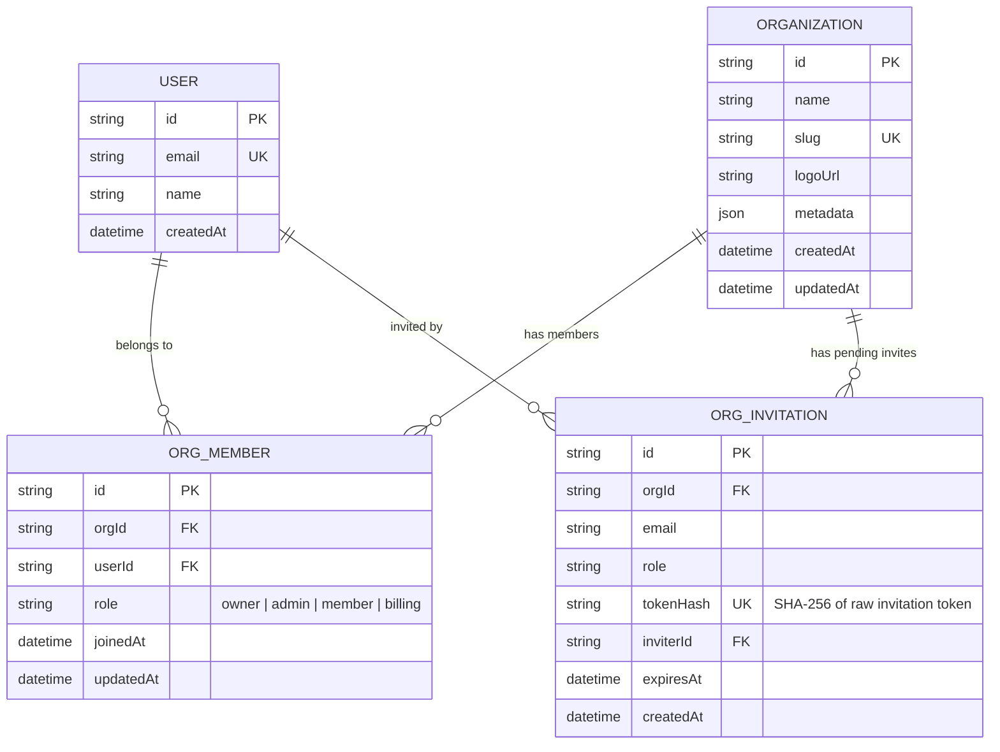
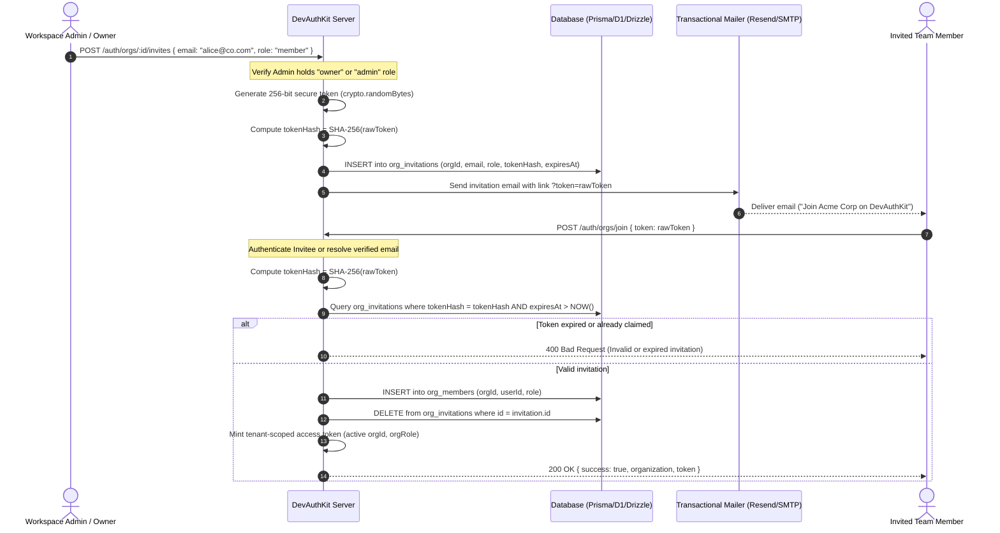
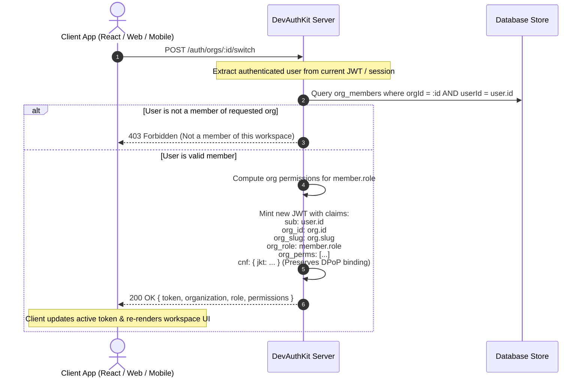
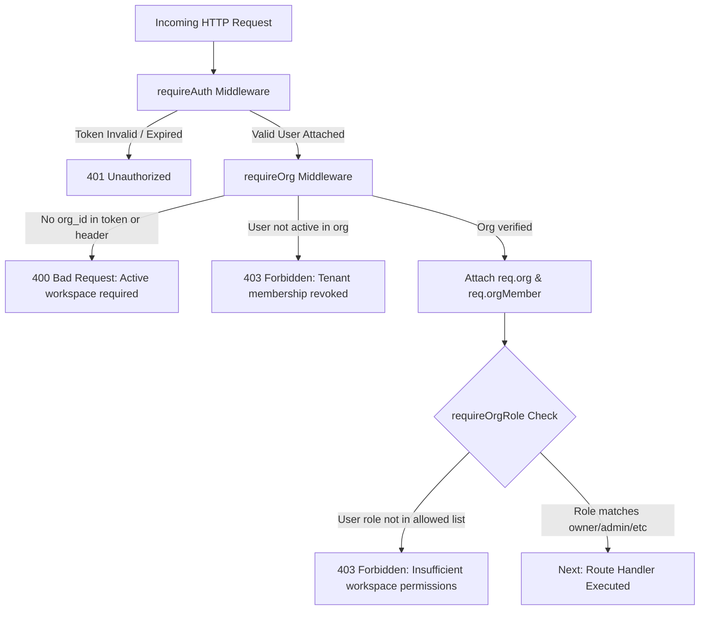

# 🏢 DevAuthKit: Multi-Tenancy & Organizations Architecture Specification

**Document Version:** 1.0.0  
**Target Module:** `devauthkit/organizations`  
**Status:** Fully Implemented & Verified
**Author:** Strategic Engineering & Security Review  

---

## 🎯 1. Executive Summary & Problem Space

In modern SaaS development, authentication is rarely limited to single-user accounts. The vast majority of B2B applications (CRMs, analytics dashboards, developer platforms, collaboration tools) operate under a **Multi-Tenant Workspace Model**:
- A single user account (`User`) can belong to multiple workspaces (`Organization`), such as "Acme Corp (Work)" and "Personal Sandbox".
- Within each Organization, users possess distinct roles and permissions (`owner`, `admin`, `member`, `billing`).
- Workspace owners and administrators must invite new team members via secure, expiring invitation tokens.
- Users must switch between active workspaces without re-authenticating.

### The SaaS "Paywall Trap"
- **Clerk** charges steep monthly fees once B2B organizations are enabled (\$100s/month + per-member surcharges).
- **WorkOS** and **Auth0** treat multi-tenancy as an enterprise-only feature with opaque custom pricing.
- **NextAuth / Auth.js** provides zero built-in organization or workspace primitives, forcing developers to spend 2–3 weeks hand-rolling relational tables, invitation tokens, permission gates, and token rotation.

### DevAuthKit's Value Proposition
> **"The premier open-source, self-hosted B2B Multi-Tenancy engine for Node.js, Express, and Cloudflare Workers (Hono)."**  
> Turnkey workspaces, cryptographically signed team invitations, role-based tenant isolation, and tenant-scoped JWTs with zero vendor fees, zero MAU limits, and complete database portability (Prisma, Drizzle, Mongoose, Cloudflare D1).

---

## 🏛️ 2. Architectural Blueprint & Data Model

### 2.1 Entity Relationship Diagram (ERD)



---

## 🔄 3. Core System Workflows

### 3.1 Team Invitation & Acceptance Ceremony

The diagram below depicts the end-to-end cryptographic invitation ceremony:



---

### 3.2 Workspace Switching & Tenant-Scoped JWT Minting



---

### 3.3 Middleware Authorization Pipeline



---

## 🔐 4. Scoped Token Claims & Security Architecture

When a workspace is active, the access token encodes tenant claims directly into the payload, avoiding database queries on hot API paths:

```json
{
  "sub": "usr_948194821",
  "email": "sarah@acme.com",
  "name": "Sarah Connor",
  "org_id": "org_774910294",
  "org_slug": "cyberdyne-systems",
  "org_role": "admin",
  "org_permissions": [
    "org:read",
    "members:read",
    "members:invite",
    "projects:create",
    "projects:delete"
  ],
  "cnf": {
    "jkt": "01xG6jPZkY9n3..."
  },
  "iat": 1729500000,
  "exp": 1729500900
}
```

### 4.1 Security Principles & Threat Mitigations

1. **Anti-Privilege Escalation:**
   - A workspace `admin` **cannot** elevate any user to `owner`.
   - Only the current `owner` can transfer ownership to another member.
   - An `owner` **cannot** leave or delete their membership without either deleting the organization or transferring ownership.
2. **Single-Use Invitation Tokens:**
   - Raw invitation tokens are sent only via transactional email (`crypto.randomBytes(32).toString('hex')`).
   - The database stores only the irreversible **SHA-256 hash** (`tokenHash`). Even if the database is read, invite tokens cannot be spoofed.
   - Invitations carry a strict TTL (default: 7 days) and are atomically consumed within a database transaction.
3. **Cross-Tenant Isolation:**
   - All tenant queries are explicitly parameterized with `orgId`.
   - Access to `/api/projects/:id` must enforce `WHERE id = :id AND org_id = :orgId` preventing Insecure Direct Object References (IDOR).
4. **DPoP Cryptographic Continuity:**
   - When a user switches workspaces via `POST /auth/orgs/:id/switch`, the newly minted token retains the client's public key thumbprint (`cnf.jkt`). Proof-of-possession is never downgraded during workspace context switching.

---

## 🗄️ 5. Database Schema & Adapter Specification

DevAuthKit will support multi-tenancy across all 4 database adapters:

### 5.1 Prisma Schema (`schema.prisma`)
```prisma
model Organization {
  id          String                  @id @default(uuid())
  name        String
  slug        String                  @unique
  logoUrl     String?
  metadata    Json?
  createdAt   DateTime                @default(now())
  updatedAt   DateTime                @updatedAt
  members     OrganizationMember[]
  invitations OrganizationInvitation[]

  @@map("organizations")
}

model OrganizationMember {
  id             String       @id @default(uuid())
  organizationId String
  userId         String
  role           String       @default("member") // owner, admin, member, billing
  joinedAt       DateTime     @default(now())
  updatedAt      DateTime     @updatedAt

  organization   Organization @relation(fields: [organizationId], references: [id], onDelete: Cascade)
  user           User         @relation(fields: [userId], references: [id], onDelete: Cascade)

  @@unique([organizationId, userId])
  @@map("organization_members")
}

model OrganizationInvitation {
  id             String       @id @default(uuid())
  organizationId String
  email          String
  role           String       @default("member")
  tokenHash      String       @unique
  inviterId      String
  expiresAt      DateTime
  createdAt      DateTime     @default(now())

  organization   Organization @relation(fields: [organizationId], references: [id], onDelete: Cascade)

  @@index([organizationId])
  @@map("organization_invitations")
}
```

### 5.2 Cloudflare D1 SQL Schema (`schema_d1_orgs.sql`)
```sql
CREATE TABLE IF NOT EXISTS organizations (
  id TEXT PRIMARY KEY,
  name TEXT NOT NULL,
  slug TEXT NOT NULL UNIQUE,
  logo_url TEXT,
  metadata TEXT,
  created_at INTEGER NOT NULL,
  updated_at INTEGER NOT NULL
);

CREATE TABLE IF NOT EXISTS organization_members (
  id TEXT PRIMARY KEY,
  org_id TEXT NOT NULL,
  user_id TEXT NOT NULL,
  role TEXT NOT NULL DEFAULT 'member',
  joined_at INTEGER NOT NULL,
  updated_at INTEGER NOT NULL,
  FOREIGN KEY (org_id) REFERENCES organizations(id) ON DELETE CASCADE,
  UNIQUE(org_id, user_id)
);

CREATE TABLE IF NOT EXISTS organization_invitations (
  id TEXT PRIMARY KEY,
  org_id TEXT NOT NULL,
  email TEXT NOT NULL,
  role TEXT NOT NULL DEFAULT 'member',
  token_hash TEXT NOT NULL UNIQUE,
  inviter_id TEXT NOT NULL,
  expires_at INTEGER NOT NULL,
  created_at INTEGER NOT NULL,
  FOREIGN KEY (org_id) REFERENCES organizations(id) ON DELETE CASCADE
);

CREATE INDEX IF NOT EXISTS idx_org_members_user ON organization_members(user_id);
CREATE INDEX IF NOT EXISTS idx_org_invitations_token ON organization_invitations(token_hash);
```

---

## 🔌 6. API Route Specification

Mounted under `/auth/orgs`:

| Method | Endpoint | Description | Required Role |
| :--- | :--- | :--- | :--- |
| `POST` | `/auth/orgs` | Create new organization (creator is `owner`) | Authenticated User |
| `GET` | `/auth/orgs` | List all organizations current user belongs to | Authenticated User |
| `GET` | `/auth/orgs/:id` | Get organization details and member list | Member of Org |
| `PATCH`| `/auth/orgs/:id` | Update organization name, slug, or logo | `owner` or `admin` |
| `DELETE`| `/auth/orgs/:id` | Delete organization permanently | `owner` only |
| `POST` | `/auth/orgs/:id/switch` | Switch active workspace & return scoped JWT | Member of Org |
| `POST` | `/auth/orgs/:id/invites` | Send invitation email to new team member | `owner` or `admin` |
| `GET` | `/auth/orgs/:id/invites` | List pending invitations for this workspace | `owner` or `admin` |
| `DELETE`| `/auth/orgs/:id/invites/:inviteId` | Revoke a pending invitation | `owner` or `admin` |
| `POST` | `/auth/orgs/join` | Accept invitation token and join organization | Authenticated User |
| `PATCH`| `/auth/orgs/:id/members/:userId` | Update member role (`admin`, `member`, etc.) | `owner` or `admin` |
| `DELETE`| `/auth/orgs/:id/members/:userId` | Remove member or leave workspace | `owner` / `admin` / Self |

---

## 🛡️ 7. Middleware API (Express & Hono)

```javascript
const { requireAuth, requireOrg, requireOrgRole, requireOrgPermission } = devAuthKit;

// 1. Ensure user has selected an active workspace
app.use("/api/workspace/*", requireAuth, requireOrg);

// 2. Protect routes by role
app.get("/api/workspace/billing", requireOrgRole(["owner", "billing"]), (req, res) => {
  res.json({
    orgId: req.org.id,
    plan: "enterprise",
    memberRole: req.orgMember.role
  });
});

// 3. Protect routes by granular permission
app.post("/api/workspace/projects", requireOrgPermission("projects:create"), (req, res) => {
  res.json({ success: true, createdBy: req.user.id });
});
```

---

## 💻 8. Universal Client SDK Integration (`DevAuthClient`)

```javascript
import { DevAuthClient } from "devauthkit/client";

const auth = new DevAuthClient({ apiUrl: "http://localhost:3000" });

// 1. Create a workspace
const { organization } = await auth.createOrg({
  name: "Acme Corp",
  slug: "acme-corp"
});

// 2. List user's workspaces
const orgs = await auth.listOrgs();

// 3. Switch active workspace (transparently updates stored token & active org)
await auth.switchOrg(organization.id);

console.log("Active Org:", auth.getActiveOrg());
// { id: "org_123", name: "Acme Corp", role: "owner" }

// 4. Invite a teammate
await auth.inviteMember(organization.id, {
  email: "teammate@example.com",
  role: "admin"
});

// 5. Teammate accepts invitation
await auth.joinOrg("raw_invitation_token_from_email");
```

---

## 📅 9. Phased Implementation Roadmap

| Phase | Milestone | Deliverables |
| :---: | :--- | :--- |
| **Phase 1** | **Core Domain & Storage Adapters** | Concrete `OrganizationAdapter` interface + Prisma, Drizzle, and Cloudflare D1 implementations. |
| **Phase 2** | **Controller & Cryptographic Invites** | Express & Hono route handlers, SHA-256 invite token hashing, Resend/SMTP email dispatcher. |
| **Phase 3** | **Authorization Middlewares** | `requireOrg`, `requireOrgRole`, and `requireOrgPermission` for Express & Hono. |
| **Phase 4** | **Client SDK & React Hooks** | `DevAuthClient` org methods (`switchOrg`, `createOrg`, `inviteMember`), `useOrg()` React hook. |
| **Phase 5** | **Automated Test Suite** | Comprehensive tests covering multi-tenant isolation, role checks, and invite lifecycles. |
